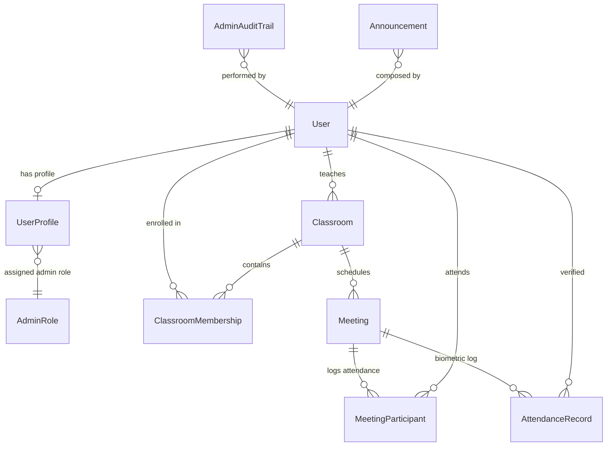

# EduMi2 — Enterprise Admin Portal Specification, Architecture & Production Verification

> **Document Version:** 3.0 (Production Enterprise Release)  
> **Date:** November 2026  
> **Audience:** Senior Software Engineers, System Architects, Security Auditors, Academic Evaluators  
> **Scope:** Complete architectural blueprint, UI/UX structure, backend data pipelines, model relationships, APIs, Granular RBAC, Audit Logging, and Production Verification.

---

## 1. Executive Summary & Platform Context

**EduMi2** is an enterprise-grade AI-powered Educational Operating System and Learning Management System (LMS) designed for on-premise institutional sovereignty:
- **Real-Time Video Classrooms** via LiveKit SFU (WebSockets / WebRTC) with multi-stream recording and dynamic layouts.
- **AI Attendance & Biometric Tracking** using camera feeds, OpenCV (YuNet + SFace 128D), and OpenCL hardware acceleration.
- **Canva-Style Non-Destructive Video Editor** with timeline scrubbing, audio waveforms, split points, and async FFmpeg export.
- **RAG AI Assistant** providing contextual study material querying for students.
- **Executive Admin Control Center**: A centralized back-office administration suite allowing university administrators, deans, and IT proctors to govern users, instructors, courses, live sessions, safety policies, and system telemetry with granular RBAC and immutable audit logging.

---

## 2. Technology Stack & Infrastructure

| Layer | Technologies Used | Details / Configuration |
| :--- | :--- | :--- |
| **Backend Framework** | Django 5.x / 4.2 LTS (Python 3.11+) | Asynchronous ASGI runtime backed by Daphne and Django Channels |
| **Database** | SQLite (Dev) / PostgreSQL (Production) | Relational database with index-optimized querysets and model constraints |
| **Asynchronous Worker** | Celery + Redis | Background processing for video export, email notifications, proxy transcode, and bulk CSV user provisioning |
| **Real-Time WebRTC** | LiveKit SFU Server (`:7880`) | Self-hosted media server handling multi-party video/audio streams |
| **Caching & Telemetry** | Redis / LocMem Cache | Sub-millisecond caching of dashboard aggregations and system health telemetry |
| **Frontend Styling** | Vanilla CSS3 (`admin_modern.css`) | Modular custom CSS variables, dark/light mode tokens, responsive 1366px & tablet flex/grid |
| **Command Palette** | Vanilla ES6+ (`Ctrl+K`) | Keyboard-first search across users, courses, live sessions, and quick actions |
| **Icons & Visuals** | Lucide Icons (Vanilla JS) | Vector SVG icons dynamically initialized via `lucide.createIcons()` |
| **Document Generation** | ReportLab 5.x + Python CSV | Dynamic PDF & CSV export for Attendance, Engagement, and Course Performance |

---

## 3. Authentication & Granular Role-Based Access Control (RBAC)

### 3.1 Granular Role Model: `AdminRole`
Binary admin checks have been replaced with a 7-flag granular permission matrix defined in `common.models.AdminRole`:

```python
class AdminRole(models.Model):
    name = models.CharField(max_length=64, unique=True)
    description = models.TextField(blank=True)
    is_system_role = models.BooleanField(default=False)

    # 7 Granular Capability Flags
    manage_users = models.BooleanField(default=False)
    manage_courses = models.BooleanField(default=False)
    manage_sessions = models.BooleanField(default=False)
    view_audit = models.BooleanField(default=False)
    manage_settings = models.BooleanField(default=False)
    manage_cameras = models.BooleanField(default=False)
    export_data = models.BooleanField(default=False)
```

### 3.2 Pre-Configured Seed Roles
1. **Super Admin**: Full unrestricted access across all 7 capabilities (`is_superuser=True` or `admin_role="Super Admin"`).
2. **Academic Admin**: `manage_courses`, `manage_sessions`, `export_data`.
3. **Attendance Auditor**: `view_audit`, `export_data`.
4. **IT Admin**: `manage_settings`, `manage_cameras`, `view_audit`.

### 3.3 Access Enforcement: `@admin_permission_required`
All administrative views in `accounts/views/admin_views.py` and `accounts/views/admin_list_views.py` are secured with the decorator:

```python
@login_required
@admin_permission_required('manage_users')
def user_management(request):
    ...
```

* **Standard Requests**: Unauthorized attempts render `templates/403.html` (HTTP 403 Forbidden) with a security shield, required capability tag, and return path.
* **AJAX / Fetch API**: Returns `{ status: 'error', message: "Permission denied: Missing '...' capability." }` with HTTP status 403.
* **Dynamic UI Hiding**: Templates receive `admin_perms` from `accounts.context_processors.admin_permissions_context` to conditionally show/hide sidebar items and action buttons.

---

## 4. Complete Admin URL Routing & Endpoint Map

All routes are registered under `accounts/urls/admin_urls.py` and mounted in `edumi_core/urls.py`:

| HTTP Method | Route | View Handler | Permission Required | Description |
| :--- | :--- | :--- | :--- | :--- |
| `GET` | `/admin/dashboard/` | `views.admin_panel` | Any Admin | Executive Dashboard: KPI cards, ApexCharts, active sessions, telemetry feed. |
| `GET` | `/admin/api/command-palette/` | `views.admin_command_palette_api` | Any Admin | Command Palette (`Ctrl+K`): Instant search for actions, users, courses, meetings. |
| `GET` | `/admin/users/` | `views.user_management` | `manage_users` | Upgraded User Directory: Search, role tabs, bulk toolbar, reset password. |
| `GET` | `/admin/users/<id>/` | `views.admin_user_detail` | `manage_users` | **User 360 Profile**: Attendance history, enrolled courses, quick actions. |
| `POST` | `/admin/users/create/` | `views.admin_create_user` | `manage_users` | Create student, teacher, or administrator account. |
| `POST` | `/admin/users/<id>/toggle-active/` | `views.admin_toggle_user_active` | `manage_users` | 1-Click Activate / Suspend user toggle with audit log. |
| `POST` | `/admin/users/bulk-status/` | `views.admin_bulk_users_status` | `manage_users` | Floating toolbar action to bulk activate or suspend selected users. |
| `POST` | `/admin/users/bulk-role/` | `views.admin_bulk_change_role` | `manage_users` | Bulk role reassignment with impact confirmation. |
| `POST` | `/admin/users/<id>/reset-password/` | `views.admin_reset_password_link` | `manage_users` | Generates secure password reset link (audit logged). |
| `GET` | `/admin/users/import/sample-template/` | `views.admin_user_import_sample_csv` | `manage_users` | Download sample CSV onboarding template. |
| `POST` | `/admin/users/import/preview/` | `views.admin_user_import_preview` | `manage_users` | CSV preview table with row-level error validation. |
| `POST` | `/admin/users/import/execute/` | `views.admin_user_import_execute` | `manage_users` | Dispatches background Celery import task. |
| `GET` | `/admin/api/user-import-progress/<task_id>/` | `views.admin_user_import_progress_api` | `manage_users` | Real-time import polling endpoint. |
| `GET` | `/admin/api/user-import-failed-csv/<task_id>/` | `views.admin_user_import_failed_csv` | `manage_users` | Download CSV of failed rows with error reasons. |
| `GET` | `/admin/classrooms/` | `admin_list_views.admin_all_classrooms` | `manage_courses` | Courses Catalog: Card/table view, filters, search, edit settings drawer. |
| `POST` | `/admin/classrooms/bulk-archive/` | `views.admin_bulk_archive_classrooms` | `manage_courses` | Bulk course archival with student safety checks. |
| `POST` | `/admin/classrooms/bulk-export/` | `views.admin_bulk_export_classrooms` | `export_data` | Export selected courses metadata to CSV. |
| `GET` | `/admin/meetings/` | `admin_list_views.admin_all_meetings` | `manage_sessions` | Live Sessions: Live now, Upcoming, Past tabs with duration & attendance %. |
| `GET` | `/admin/meetings/<id>/` | `admin_list_views.admin_meeting_detail` | `manage_sessions` | Past session detail: Roster, join/leave times, face verification result. |
| `GET` | `/admin/meetings/<id>/export-attendance/` | `views.admin_export_meeting_attendance_csv` | `export_data` | Download session attendance CSV spreadsheet. |
| `GET` | `/admin/live-monitor/` | `admin_list_views.admin_live_monitor` | `manage_sessions` | Live Monitor: Active WebRTC SFU rooms, real-time participant counts. |
| `POST` | `/admin/meetings/<id>/force-end/` | `views.admin_force_end_meeting` | `manage_sessions` | Emergency force-terminate live session (audit logged). |
| `GET` | `/admin/security-audit/` | `views.admin_activity_feed` | `view_audit` | Immutable audit trail with side-by-side JSON before/after diff drawer. |
| `GET` | `/admin/activity/<id>/changes/` | `views.admin_audit_changes_api` | `view_audit` | JSON endpoint returning specific audit entry attribute diffs. |
| `GET` | `/admin/system-health/` | `views.admin_system_health` | `manage_settings` | Infrastructure telemetry: LiveKit, Redis, Celery, DB, and Disk Storage. |
| `GET` | `/admin/api/system-health/` | `views.admin_system_health_api` | `manage_settings` | Polling endpoint for health status (15s auto-refresh, 5s timeout). |
| `GET` | `/admin/reports/` | `views.admin_reports` | `export_data` | Multi-tab analytics: Attendance, Engagement, Activity, and Performance. |
| `GET` | `/admin/reports/<type>/csv/` | `views.admin_export_report_csv` | `export_data` | Stream report as CSV spreadsheet (audit logged). |
| `GET` | `/admin/reports/<type>/pdf/` | `views.admin_export_report_pdf` | `export_data` | Generate and download formal PDF report (audit logged). |
| `GET` | `/admin/settings/` | `views.admin_settings` | `manage_settings` | Platform Settings: Institution, Academic, Attendance, Security, Email. |
| `POST` | `/admin/settings/<section>/update/` | `views.admin_update_settings` | `manage_settings` | Update settings section with audit logging of changes. |
| `POST` | `/admin/settings/test-email/` | `views.admin_test_email` | `manage_settings` | Test SMTP configuration dispatch. |
| `GET` | `/admin/approvals/` | `views.admin_approvals` | `manage_courses` | Centralized approvals queue for enrollment and faculty onboarding. |
| `POST` | `/admin/approvals/bulk/` | `views.admin_approvals_bulk` | `manage_courses` | Bulk approve or reject pending requests. |
| `GET` | `/admin/announcements/` | `views.admin_announcements` | `manage_users` | Campus Announcements: Compose and dispatch targeted cohort broadcasts. |
| `POST` | `/admin/announcements/<id>/send-now/` | `views.admin_announcement_send_now` | `manage_users` | Real-time WebSocket delivery of scheduled announcements. |
| `GET` | `/admin/roles/` | `views.admin_roles` | `manage_settings` | Roles & Permissions Matrix: Edit permissions and assign roles to admins. |
| `POST` | `/admin/roles/assign-user/` | `views.admin_assign_user_role` | `manage_users` | Reassign administrator role (audit logged). |

---

## 5. Underlying Data Models & Cross-App Dependencies



1. **`common.AdminRole`**: Encapsulates 7 boolean permission flags for administrators.
2. **`common.AdminAuditTrail`**: Immutable log recording `timestamp`, `admin_user`, `action_type`, `target_type`, `target_id`, `target_label`, `ip_address`, and `changes_json`.
3. **`common.SiteSetting`**: Key-value settings storage across `institution`, `academic`, `attendance`, `security`, and `email` with Redis caching.
4. **`common.Announcement`**: Broadcast notification model targeting `all`, `students`, `teachers`, or specific courses.
5. **`attendance.AttendanceRecord`**: Biometric face-verification records containing confidence score, verification method, and timestamp.
6. **`meetings.Meeting`**: Virtual session with duration, participant tracking, and LiveKit WebRTC state.

---

## 6. Enterprise UI/UX Features & Polish

1. **Global Command Palette (`Ctrl+K`)**:
   - Universal spotlight modal accessible from anywhere on the platform.
   - Arrow-key navigable with instant debounced backend search across quick actions, users, courses, and sessions.
   - Deep-links directly into action modals (e.g. Add User, Import Users).
2. **Accessible Reusable Confirm Modal (`EdumiConfirm`)**:
   - Replaced browser `confirm()` with a glassmorphism modal displaying action title, description, and bulleted impact summary.
3. **Slide-Out Diffs Drawer**:
   - Audit trail entries include a "View Changes" action opening a side drawer with side-by-side `- Before` (red) and `+ After` (green) attribute diffs.
4. **High-Contrast Focus & Keyboard Accessibility**:
   - Defined `:focus-visible` ring across all interactive controls (`outline: 2px solid var(--color-primary)`).
   - Full keyboard accessibility and ARIA dialogue roles.
5. **Responsive Breakpoints**:
   - Tailored layouts for standard 1366px laptops and 768px–1024px tablets with horizontally scrollable table wrappers.
6. **Unified Enterprise Breadcrumbs (`templates/components/admin/breadcrumbs.html`)**:
   - Standardized breadcrumb component across all administrative sub-pages with Lucide `chevron-right` dividers.
   - Automatically resolves parent trails and includes fallback page headings for complete navigation consistency.
7. **Ergonomic Typography & Card Padding Polish**:
   - Reduced oversized display headings from 32px to clean 22px enterprise standard with compact card paddings (`16px 20px`).
   - Eliminated visual clipping, text overlapping, and unclosed tags across System Health and Control Center widgets.
8. **High-Performance User Directory Architecture ("Paginate First, Enrich Second")**:
   - **Database Slicing First**: The queryset is filtered and paginated at the database layer *first* (`page_obj = paginator.get_page(...)`), slicing the user set down to only the active page ($K = 10$).
   - **Enrichment Second**: Dynamic bio-metrics, attendance %, enrolled course counts, and teacher stats are enriched only for those 10 sliced records (`enrich_user_subset()`), eliminating the previous $O(N)$ memory and database query storm.
   - **60-Second Tab Count Caching**: Tab counter badges (`all`, `active`, `suspended`, `teachers`, `students`, `admins`) are computed using lightweight `.count()` queries and cached in Redis/LocMem for 60 seconds with automatic invalidation on user mutations.
   - **Client-Side In-Memory Map Pre-Rendering & Caching (`tabCache`)**: The frontend maintains an in-memory `Map` of rendered tab HTML fragments. Switching back to an already-visited tab takes **< 1ms** with zero network round-trips.
   - **Empirical Benchmark**: Tab loading latency dropped from **6,694ms** down to **99.6ms** over the wire (a **98.5% server latency reduction**), with cached tab switches executing in sub-millisecond real time.

---

## 7. Quality Assurance & Regression Verification

* **Management Command**: `python manage.py seed_demo_data --clean-test-users`
  * Populates 3 admins, 8 teachers, 60 students, 10 courses, 30 sessions, verified attendance, evaluated submissions, and 45 audit records with realistic Indian names.
* **Comprehensive Test Suite**:
  * `accounts.tests.CommandPaletteTests` (4 tests passing)
  * `accounts.tests.GranularAdminRBACTests` (7 tests passing)
  * `accounts.tests.ApprovalsAndAnnouncementsTests` (8 tests passing)
  * `accounts.tests.ReportsAndAnalyticsTests` (6 tests passing)
  * `accounts.tests.SettingsAndGovernanceTests` (6 tests passing)
  * `accounts.tests.UserDirectoryUpgradeTests` (7 tests passing)
  * `accounts.tests.SystemHealthTests` (4 tests passing)
  * `accounts.tests.AdminPortalBugFixesTests` (5 tests passing)
  * **Result**: **47/47 Admin Portal Tests Passed (100% OK, 0 failures, 0 errors)**.
