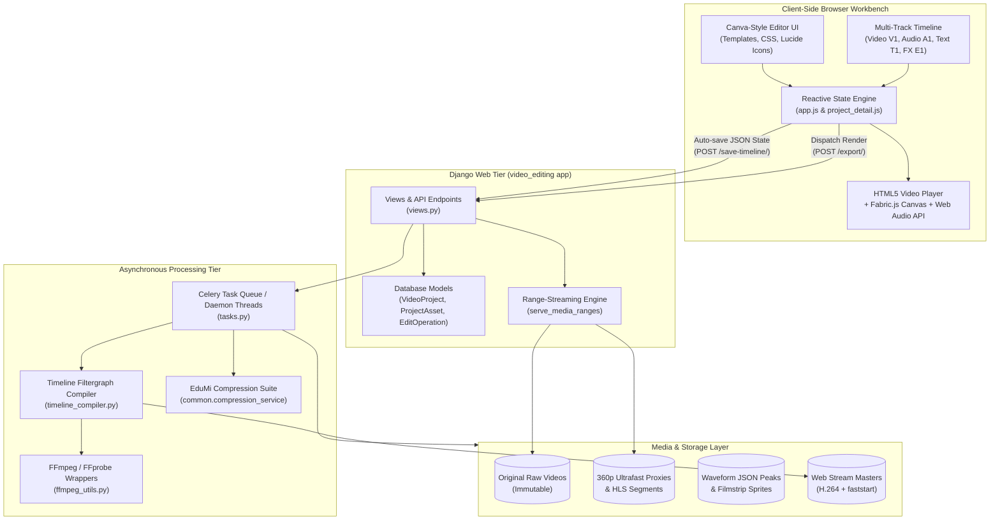
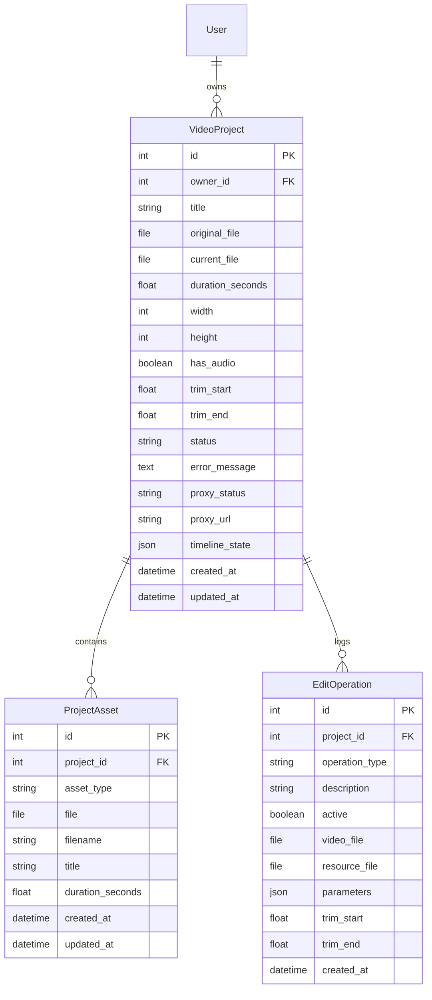
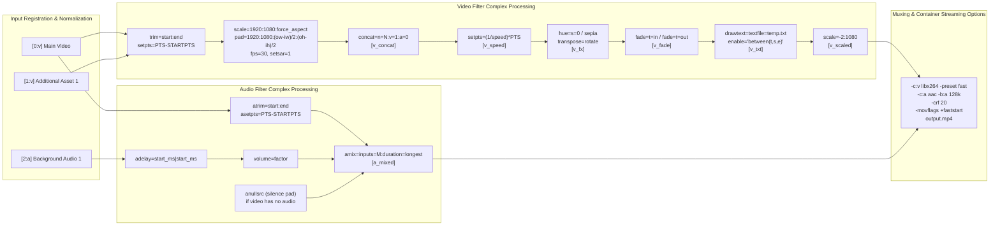
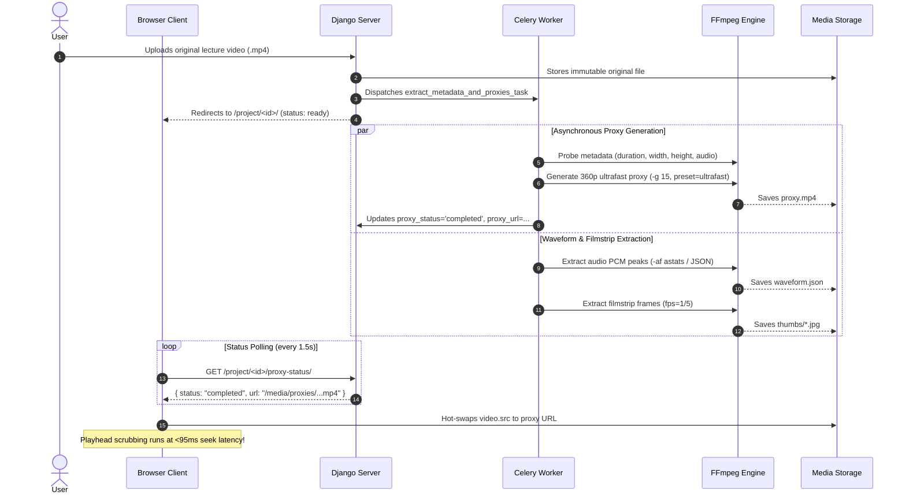
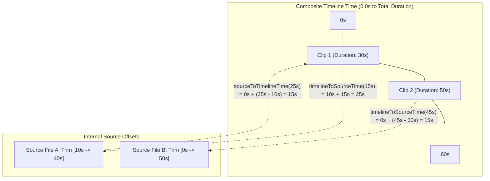

# 🎬 Video Editing Module — Complete Technical Architecture & Specification

> **Comprehensive Reference Manual for the Edumi Video Editing Suite**  
> Covers backend architecture, data models, timeline JSON schema, FFmpeg filtergraph compilation, high-performance proxy pipelines, UI/UX component layout, client-side state synchronization, and REST/AJAX API specifications.

---

## 📑 Table of Contents
1. [Executive Summary & System Architecture](#1-executive-summary--system-architecture)
2. [Data Models & Persistence Layer](#2-data-models--persistence-layer)
3. [Timeline State JSON Schema & Specifications](#3-timeline-state-json-schema--specifications)
4. [FFmpeg Compilation & Filtergraph Engine](#4-ffmpeg-compilation--filtergraph-engine)
5. [High-Performance Proxy & Media Streaming Engine](#5-high-performance-proxy--media-streaming-engine)
6. [UI & UX Component Architecture](#6-ui--ux-component-architecture)
7. [Frontend Client Logic & State Synchronization](#7-frontend-client-logic--state-synchronization)
8. [Complete API Endpoints Reference](#8-complete-api-endpoints-reference)
9. [Publishing, Classroom Integration & Workflows](#9-publishing-classroom-integration--workflows)
10. [Security, Performance & Failure Recovery](#10-security-performance--failure-recovery)

---

## 1. Executive Summary & System Architecture

The `video_editing` application in Edumi is an industry-grade, Canva- and CapCut-style non-destructive web video editing and rendering suite. It empowers teachers, students, and content creators to trim, split, reorder, adjust speed, mix multi-track audio, overlay dynamic text, apply visual filters, and compile high-resolution lecture videos directly within the web browser.

### 1.1 High-Level Architecture Diagram



### 1.2 Core Design Principles
- **Non-Destructive Editing**: The original uploaded media (`original_file`) is **never overwritten or altered**. Every operation updates a lightweight, declarative JSON timeline state (`timeline_state`).
- **Decoupled Preview vs. Server Rendering**: Real-time canvas previews, audio waveforms, and clip boundaries run at 60 FPS in the browser using HTML5 Video, Canvas, and Web Audio API without taxing backend resources. Full-fidelity rendering is offloaded to asynchronous background FFmpeg workers.
- **Zero Scrubbing Latency**: Heavy source videos (4K/1080p, 60fps) are automatically proxied into lightweight 360p ultrafast keyframe-dense MP4/HLS streams (`g=15`), reducing playhead seek latency to **sub-100ms**.
- **Instant Web Streaming (`faststart`)**: All exported videos relocate the MP4 `moov` atom header to the beginning of the container file (`-movflags +faststart`), allowing students to stream exported lectures immediately before the entire multi-gigabyte file finishes downloading.

---

## 2. Data Models & Persistence Layer

The data layer is defined in `video_editing/models.py` and consists of three core relational models:



### 2.1 `VideoProject` Model
The central entity representing a user's editing workspace.

| Field | Type | Description |
| :--- | :--- | :--- |
| `owner` | `ForeignKey(User)` | The user who created and owns the editing project. Cascades on user deletion. |
| `title` | `CharField(255)` | Editable project name. Defaults to the uploaded video file's base name. |
| `original_file` | `FileField` | Immutable path to the pristine source upload (`media/videos/<user_id>/<uuid>.<ext>`). |
| `current_file` | `FileField` | Pointer to the compiled/exported video file. `null` if project has not been exported. |
| `duration_seconds` | `FloatField` | Source media duration extracted by `ffprobe`. |
| `width` / `height` | `IntegerField` | Frame dimensions (e.g., 1920×1080). |
| `has_audio` | `BooleanField` | True if the source file contains an audio stream. |
| `trim_start` / `trim_end`| `FloatField` | Legacy trim bounds in seconds for backwards compatibility. |
| `status` | `CharField(20)` | Compilation status: `ready`, `processing`, or `error`. |
| `error_message` | `TextField` | Captures FFmpeg stderr output if compilation encounters an error. |
| `proxy_status` | `CharField(20)` | Proxy encoding state: `none`, `pending`, `processing`, `completed`, `failed`. |
| `proxy_url` | `CharField(500)` | URL/path to the generated lightweight 360p MP4 or HLS `proxy.m3u8` stream. |
| `timeline_state` | `JSONField` | The complete serialized timeline document (tracks, clips, audio, text, effects). |

#### Key Model Properties:
- `display_title`: Sanitizes UUID filenames into clean, user-friendly project labels.
- `working_file`: Resolves to `current_file` (if an export exists) or falls back to `original_file`.
- `has_unexported_edits`: Smart dirty-state detection. Returns `True` if:
  1. Project status is `"processing"`.
  2. The project was never exported and possesses non-default edits (trims, speed, filters, text overlays).
  3. New `EditOperation` records exist with a timestamp newer than the last `timeline_export`.

### 2.2 `ProjectAsset` Model
Represents supplementary media files (B-roll footage, sound effects, background music, watermark images) imported into the project library.

| Field | Type | Description |
| :--- | :--- | :--- |
| `project` | `ForeignKey(VideoProject)`| Parent project reference with `related_name="assets"`. |
| `asset_type` | `CharField(10)` | Category: `video`, `audio`, or `image`. |
| `file` | `FileField` | Stored under `media/videos/<owner_id>/<uuid>.<ext>`. |
| `filename` | `CharField(255)` | Original client-side filename. |
| `title` | `CharField(255)` | User-renamable display title. |
| `duration_seconds` | `FloatField` | Extracted duration for audio and video assets (null for static images). |

### 2.3 `EditOperation` Model
An audit trail and undo/redo history stack for project actions.

| Field | Type | Description |
| :--- | :--- | :--- |
| `project` | `ForeignKey(VideoProject)`| Associated project. |
| `operation_type` | `CharField(30)` | Action type: `upload`, `trim`, `mute`, `unmute`, `volume`, `merge`, `text_overlay`, `speed`, `rotate`, `resize`, `grayscale`, `fade`, `reset`. |
| `description` | `CharField(500)` | Human-readable log entry (e.g., *"Trimmed video to 0:04 - 0:42"*). |
| `active` | `BooleanField` | Undo/redo flag. `False` marks an action that has been reverted. |
| `parameters` | `JSONField` | Snapshot of parameters applied during the operation. |

---

## 3. Timeline State JSON Schema & Specifications

The browser timeline and backend compiler exchange state through a structured JSON document stored in `VideoProject.timeline_state`.

### 3.1 Complete JSON Schema Example

```json
{
  "version": "2.0",
  "exportResolution": "1080p",
  "exportQuality": "high",
  "speed": 1.0,
  "audio_deleted_by_user": false,
  "trim": {
    "start": 0.0,
    "end": 124.5,
    "mode": "extract",
    "fade_in": false,
    "fade_out": false
  },
  "audio": {
    "volume": 1.0,
    "muted": false
  },
  "effects": {
    "grayscale": false,
    "rotate": 0,
    "fade": {
      "in": 1.5,
      "out": 2.0
    }
  },
  "resize": {
    "width": 1920,
    "height": 1080
  },
  "clips": [
    {
      "id": "clip-1",
      "title": "Intro_Recording.mp4",
      "start": 0.0,
      "end": 35.0,
      "trimStart": 5.0,
      "trimEnd": 40.0,
      "duration": 35.0,
      "url": "/media/videos/1/intro.mp4",
      "path": "/var/www/media/videos/1/intro.mp4",
      "volume": 1.0,
      "muted": false,
      "speed": 1.0,
      "filter": null
    },
    {
      "id": "clip-2",
      "title": "Main_Lecture.mp4",
      "start": 35.0,
      "end": 115.0,
      "trimStart": 0.0,
      "trimEnd": 80.0,
      "duration": 80.0,
      "url": "/media/videos/1/lecture.mp4",
      "path": "/var/www/media/videos/1/lecture.mp4",
      "volume": 0.9,
      "muted": false,
      "speed": 1.0,
      "filter": "grayscale"
    }
  ],
  "tracks": [
    {
      "id": "track-v1",
      "type": "video",
      "name": "Main Video Track",
      "clips": [ /* clip-1, clip-2 objects */ ]
    },
    {
      "id": "track-a1",
      "type": "audio",
      "name": "Background Music & Voice",
      "clips": [
        {
          "id": "audio-bg-1",
          "name": "Classroom_Ambience.mp3",
          "filename": "Classroom_Ambience.mp3",
          "path": "/var/www/media/videos/1/ambient.mp3",
          "start": 0.0,
          "end": 115.0,
          "trimStart": 0.0,
          "trimEnd": 115.0,
          "bg_volume": 0.35,
          "video_volume": 1.0,
          "is_detached": false
        }
      ]
    },
    {
      "id": "track-t1",
      "type": "text",
      "name": "Titles & Subtitles",
      "clips": [
        {
          "id": "txt-overlay-1",
          "text": "Chapter 1: Quantum Physics Intro",
          "position": "bottom",
          "color": "#ffffff",
          "fontsize": 48,
          "start": 2.0,
          "end": 10.0
        },
        {
          "id": "txt-overlay-2",
          "text": "Dr. Smith, Professor of Physics",
          "position": "custom:10.0,85.0",
          "color": "#fbbf24",
          "fontsize": 36,
          "start": 12.0,
          "end": 20.0
        }
      ]
    },
    {
      "id": "track-e1",
      "type": "effect",
      "name": "Filters & Color Grading",
      "clips": [
        {
          "id": "fx-1",
          "effect": "sepia",
          "start": 35.0,
          "end": 60.0
        }
      ]
    }
  ]
}
```

### 3.2 Property Specifications & Constraints

| Block | Key | Type | Description & Permitted Values |
| :--- | :--- | :--- | :--- |
| **Root** | `exportResolution` | `string` | Target rendering scale: `'480p'`, `'720p'`, `'1080p'` (default), `'1440p'`, `'4k'`. |
| | `exportQuality` | `string` | CRF profile: `'low'` (28), `'medium'` (23), `'high'` (20), `'ultra'` (16). |
| | `speed` | `float` | Global playback multiplier (`0.25` to `4.0`). |
| **`trim`** | `start` / `end` | `float` | In/Out boundaries in seconds. |
| | `mode` | `string` | `'extract'` (keeps `[start, end]`) or `'delete'` (removes `[start, end]`). |
| | `fade_in` / `fade_out`| `bool` | Auto-apply 1-second linear black fade at start/end. |
| **`audio`**| `volume` | `float` | Audio multiplier: `0.0` (silent) to `2.0` (200% boost). |
| | `muted` | `bool` | Completely silences or drops audio streams. |
| **`effects`**| `grayscale` | `bool` | Hue desaturation filter (`hue=s=0`). |
| | `rotate` | `int` | Rotation in degrees: `0`, `90`, `180`, `270`. |
| | `fade` | `object` | Custom durations: `{ in: float, out: float }`. |
| **`text_overlays`**| `position` | `string` | Preset (`'top'`, `'center'`, `'bottom'`) or coordinate (`'custom:X%,Y%'`). |
| | `fontsize` | `int` | Font size in points (clamped between `8` and `240`). |
| | `color` | `string` | Named CSS color or hex string (`#ffffff`). |
| **`clips`**| `start` / `end` | `float` | Placement timeline offsets along the continuous horizontal axis. |
| | `trimStart` / `trimEnd`| `float` | Source media internal trimming offsets. |

---

## 4. FFmpeg Compilation & Filtergraph Engine

The compilation engine is implemented in `video_editing/timeline_compiler.py` and `video_editing/ffmpeg_utils.py`. It converts the complex multi-track JSON timeline into an optimized, single-pass FFmpeg filtergraph.

### 4.1 Filtergraph Processing Pipeline



### 4.2 Key Filtergraph Stages in Code

#### 1. Input Aspect Ratio & SAR Normalization
When concatenating clips from different cameras or smartphones with mismatched aspect ratios or pixel aspect ratios (SAR), standard concatenation produces frame jitter or crash. The compiler normalizes every clip stream:
```text
[0:v]trim=start=0:end=15,setpts=PTS-STARTPTS,scale=1920:1080:force_original_aspect_ratio=decrease,pad=1920:1080:(ow-iw)/2:(oh-ih)/2,setsar=1,fps=30[v0]
```

#### 2. Multi-Rate Audio Tempo Adjustment (`atempo`)
FFmpeg's `atempo` filter supports speed factors only between `0.5` and `2.0`. For extreme speeds (e.g., `4.0x` or `0.25x`), the compiler automatically chains multiple filters:
```python
atempo_filters = []
rem = speed_factor
while rem > 2.0:
    atempo_filters.append("atempo=2.0")
    rem /= 2.0
while rem < 0.5:
    atempo_filters.append("atempo=0.5")
    rem /= 0.5
atempo_filters.append(f"atempo={rem}")
filter_complex.append(f"{current_a}{','.join(atempo_filters)}{next_a}")
```

#### 3. Secure Drawtext Text File Overlays
To protect against shell command injection and parser corruption from quotes, backslashes, and emojis in user text overlays, the compiler writes text content to UTF-8 temporary files:
```python
tf = tempfile.NamedTemporaryFile('w', delete=False, suffix='.txt', encoding='utf-8')
tf.write(raw_txt)
tf.close()
safe_text_path = tf.name.replace('\\', '/').replace(':', r'\:')
font_arg = _get_font_arg() # C\:/Windows/Fonts/arial.ttf
drawtext_filter = (
    f"{current_v}drawtext={font_arg}textfile='{safe_text_path}':"
    f"x={x}:y={y}:fontsize={fontsize}:fontcolor={fontcolor}:"
    f"box=1:boxcolor=black@0.5:boxborderw=8:enable='between(t\\,{start:.2f}\\,{end:.2f})'{next_v}"
)
```

#### 4. Audio Alignment & Mixing (`adelay` + `amix`)
Background audio clips are placed at arbitrary timestamps on the timeline. The compiler offsets them using `adelay` in milliseconds:
```text
[2:a]atrim=0:60,asetpts=PTS-STARTPTS,adelay=15000|15000,volume=0.35,aformat=sample_rates=44100:channel_layouts=stereo[a_trimmed_0];
[v_concat_audio][a_trimmed_0]amix=inputs=2:duration=longest:dropout_transition=0[a_mixed]
```

#### 5. Web Streaming Optimization (`-movflags +faststart`)
By default, MP4 containers write the index metadata (`moov` atom) at the end of the file. The compiler appends `-movflags +faststart` to shift the `moov` atom to the front, allowing immediate browser playback without buffering the entire file.

---

## 5. High-Performance Proxy & Media Streaming Engine

Editing 1-hour 4K/1080p lecture videos in a web browser directly freezes client memory and causes severe playback stutter. The `video_editing` app incorporates a 3-tier proxy acceleration architecture:



### 5.1 Proxy Generation Specifications
- **Resolution**: `scale=-2:360` (360p height, proportional width divisible by 2).
- **Encoder Settings**: `libx264`, `preset=ultrafast`, `crf=28`.
- **GOP Interval**: `-g 15` (forces an IDR I-frame every 15 frames / 0.5s).
- **Benchmark Results**:
  - Processing time: **< 10 seconds** for a 15-minute video.
  - Seek latency in HTML5 video: **~95 ms** (compared to 850–1200 ms on original files).

### 5.2 HLS Adaptive Proxy for Long Lectures (> 1 Hour)
For massive multi-gigabyte recordings, `tasks.generate_hls_proxy()` segments the video into 2-second transport stream chunks (`.ts`) and a master playlist (`proxy.m3u8`). The browser initializes `hls.js`, requesting only the segments surrounding the playhead.

### 5.3 HTTP Range Media Streaming (`serve_media_ranges`)
All media files served to the editor utilize HTTP 206 Partial Content responses:
- Enables seeking forward/backward without buffering previous bytes.
- Fully compatible with Safari iOS and Chrome desktop scrubbing mechanics.

---

## 6. UI & UX Component Architecture

The user interface is modeled in `templates/video_editing/project_detail.html` and styled via `static/video_editing/css/editor.css`.

### 6.1 Screen Anatomy & Grid Layout

```
+---------------------------------------------------------------------------------------------------+
|  [Logo]  [Project Name Input  ✏️] [Saving/Saved]        [Undo] [Redo] [History]  [Export] [Publish] |
+-----------------------------------------------------------------+---------------------------------+
|                                                                 |  [Media] [Text] [Audio] [Effects]
|                                                                 |---------------------------------+
|                                                                 |  [ + Upload Files ]  [...]      |
|                       VIDEO STAGE                               |  [Images] [Videos] [Audio]      |
|                                                                 |---------------------------------+
|        +-----------------------------------------------+        |  [Thumb 1]  [Thumb 2]           |
|        |                                               |        |  Clip A     Clip B              |
|        |            HTML5 <video> Preview              |        |  [Thumb 3]  [Thumb 4]           |
|        |         + Fabric.js Overlay Canvas            |        |  Audio 1    Graphic 2           |
|        |         + Live Text Overlays Container        |        |                                 |
|        |                                               |        |                                 |
|        +-----------------------------------------------+        |                                 |
|                                                                 |                                 |
|    [⏮] [⏪ 5s] [ ▶ / ⏸ ] [⏩ 5s] [⏭]   00:01:23 / 00:05:00   [🔊 --O--] [⛶] |                                 |
+-----------------------------------------------------------------+---------------------------------+
|  ================== TIMELINE RESIZER HANDLE (DRAG UP/DOWN) =======================================  |
+---------------------------------------------------------------------------------------------------+
|  [Delete] [Split (S)] [Merge] [Duplicate] [+ Add Clip]  [Speed: 1x ▾]  |  [Fit] [-] [+] [Fullscreen]
+---------------------------------------------------------------------------------------------------+
|  TIMELINE RULER: |---|---|---|---|---|---|---|---|---|---|---|---|---|---|---|---|---|---|---|---|
+---------------------------------------------------------------------------------------------------+
|  [V1] Video Track   | [ Clip 1 Thumbnails... ] | [ Clip 2 Thumbnails... ]                       |
|  [A1] Audio Track   | ~~~~~ Waveform ~~~~~~~~ | ~~~~~ Waveform ~~~~~~~~~~~~~~~~~~~~~~~~~~~~~~~  |
|  [T1] Text Track    | [ "Chapter 1 Title" ]   |                 [ "Dr. Smith Caption" ]         |
|  [E1] Effects Track |                         | [ Grayscale FX ]                                |
|                     |                       ▲                                                    |
|                     |                  (Playhead)                                                |
+---------------------------------------------------------------------------------------------------+
|  [ 4 Tracks Active ]                                                            [ Zoom Fit ] [ ⛶ ]|
+---------------------------------------------------------------------------------------------------+
```

### 6.2 Key UI Components Breakdown

#### 1. Header Toolbar (`.ve-editor-head`)
- **In-Place Project Title Renaming**: Debounced auto-saving input with automatic width resizing, pencil trigger button, and status indicators (`Saving...` / `Saved`).
- **Undo / Redo Stack**: State snapshot traversal (`Ctrl+Z`, `Ctrl+Shift+Z`).
- **History Drawer Toggle**: Slides open the edit audit trail from the right margin.
- **Master Export Button**: Dispatches the background compilation task.
- **Publish to Lecture Button**: Directly deploys the rendered video into the school classroom recording portal.

#### 2. Video Stage (`.ve-video-stage`)
- **Main `<video>` Element**: Renders 360p proxy or full file with hardware-accelerated playback.
- **Fabric.js Canvas Layer (`#fabric-stage-canvas`)**: Allows freehand annotations and bounding-box manipulations over video frames.
- **Live Text Overlay Box (`#text-overlay-container`)**: Renders real-time typography overlays with exact CSS font sizes, colors, and letterboxes.
- **Custom Player Controls**:
  - Frame stepping (skip to start, step back 5s, forward 5s, skip to end).
  - Timecode display pill formatted down to millisecond precision (`HH:MM:SS.mmm`).
  - Interactive volume fader with mute toggle.
  - Video fullscreen toggle.

#### 3. Right Tool Drawer (`.ve-tool-panel`)
Tabbed container with 4 dedicated panels:
- **Media Panel**:
  - Filter category tabs: Images, Videos, Audio, Folders.
  - Responsive thumbnail cards showing duration badges, file titles, and context menus (Insert, Rename, Download, Delete).
  - Drag-and-drop file ingestion support.
- **Text Panel**: Subtitle and title generator with position presets (`top`, `center`, `bottom`, `custom coordinates`), color picker, and start/end timecode synchronization.
- **Audio Panel**: Background audio file uploader with waveform peak preview, track volume faders, and *"Set from playhead"* shortcut buttons.
- **Effects Panel**: Real-time CSS and FFmpeg filter adjustments (Rotation 90°/180°/270°, Custom Resolution Scaler, Grayscale toggle, Fade-in/Fade-out controls).

#### 4. Multi-Track Timeline (`.visual-trim-container`)
- **Vertical Resizer (`#timeline-resizer`)**: Allows dragging up/down to adjust timeline height, with double-click toggle to minimize/expand.
- **Timeline Toolbar**:
  - `Delete`: Removes selected clip.
  - `Split (S)`: Divides the active clip at the exact playhead position into two independent clips.
  - `Merge (M)`: Combines two adjacent split clips back into one continuous segment.
  - `Duplicate (Ctrl+D)`: Clones the active item.
  - `Add Clip`: Appends media from the asset library to the timeline end.
  - `Speed Selector`: Dropdown for `0.5x`, `0.75x`, `1.0x`, `1.25x`, `1.5x`, `2.0x`.
  - `Zoom Controls`: Zoom Fit, Zoom In (`+`), Zoom Out (`-`).
- **Pinned Ruler Header (`#trim-ruler-header`)**:
  - Dynamic time ticks calculated from zoom scale (`pxPerSecond`).
  - Sticks to the top of the timeline during vertical scrolling; syncs horizontally with track scrubbing.
- **Track Stacks**:
  - **Video Track (V1)**: Filmstrip thumbnail ribbon, drag-handles for head/tail trimming, dimmed masks for cut regions.
  - **Audio Track (A1)**: Detached native audio or background music with live SVG waveform visualization.
  - **Text Track (T1)**: Color-coded text overlay duration blocks.
  - **Effects Track (E1)**: Visual filter and speed modification badges.
- **Interactive Playhead (`#trim-playhead`)**: Unified vertical line cutting through all tracks with a real-time timecode tooltip.
- **Magnetic Snapping Guide (`#timeline-snap-guide`)**: Snaps clips and playhead to clip edges and split boundaries within a 10px snap radius.

#### 5. History Slide-Out Drawer (`.ve-history-drawer`)
- Displays chronological list of user operations with badges, relative timestamps, and operation parameter snapshots.
- Includes a *"Reset to Original"* button with confirmation modal to discard all changes and revert to pristine upload.

---

## 7. Frontend Client Logic & State Synchronization

The client-side intelligence is split across two core scripts:
1. `static/video_editing/js/project_detail.js` (Workbench bootstrap, proxy source management, project renaming, history drawer).
2. `static/video_editing/js/app.js` (Timeline controller, clip manipulation, dual-time mapping, canvas rendering, auto-save).

### 7.1 Dual-Time Coordinate Mapping Engine

When multiple clips are trimmed, split, and concatenated, the continuous timeline position ($t_{\text{timeline}}$) diverges from the source video's internal clock ($t_{\text{source}}$). The engine provides bidirectional coordinate transformation:



#### Mathematical Implementation in `app.js`:
```javascript
function timelineToSourceTime(tTimeline) {
  const clips = editorState.video_clips || [];
  if (clips.length === 0) return tTimeline;
  
  tTimeline = Math.max(0, Math.min(tTimeline, duration || 0));
  for (let i = 0; i < clips.length; i++) {
    const clip = clips[i];
    if (tTimeline >= clip.start && (tTimeline < clip.end || i === clips.length - 1)) {
      activePlayingClipIndex = i;
      const offset = Math.max(0, tTimeline - clip.start);
      const trimStart = parseFloat(clip.trimStart || 0);
      return trimStart + Math.min(offset, clip.duration);
    }
  }
  return tTimeline;
}
```

### 7.2 Buttery-Smooth Playhead Loop
Rather than relying solely on HTML5 video `timeupdate` events (which only fire 3–4 times per second), `app.js` drives playhead motion using `requestAnimationFrame`:
```javascript
function startSmoothPlayhead() {
  function loop() {
    if (!video.paused && !video.ended) {
      updatePlayheadSmooth();
      animFrameId = requestAnimationFrame(loop);
    }
  }
  animFrameId = requestAnimationFrame(loop);
}
```

### 7.3 Debounced Auto-Save Mechanism
Edits made in the browser (moving clips, trimming boundaries, changing text) trigger `autoSaveTimeline()`:
- Debounced by **800ms** to avoid saturating the network during rapid dragging.
- Transmits the complete payload via `fetch(REEL_PROJECT_SAVE_TIMELINE_URL, { method: "POST", body: payload })`.
- Handles CSRF token injection and updates the save indicator.

---

## 8. Complete API Endpoints Reference

All video editing endpoints are registered under `/video_editing/` (defined in `video_editing/urls.py`):

| Method | Endpoint | View Function | Description |
| :--- | :--- | :--- | :--- |
| `GET` / `POST` | `/` | `project_list` | Dashboard listing user projects; handles initial base video upload. |
| `POST` | `/chunked-upload/` | `chunked_upload_view` | High-res chunked upload endpoint for multi-gigabyte files. |
| `GET` | `/project/<id>/` | `project_detail` | Main editing studio workbench. |
| `POST` | `/project/<id>/rename/` | `project_rename` | AJAX endpoint to update project title. |
| `POST` | `/project/<id>/save-timeline/` | `save_timeline` | JSON timeline auto-save endpoint. |
| `POST` | `/project/<id>/export/` | `export_project` | Dispatches background Celery rendering task. |
| `GET` | `/project/<id>/status/` | `project_status` | Polling endpoint for compilation status (`ready`, `processing`, `error`). |
| `GET` | `/project/<id>/proxy-status/` | `proxy_status_view` | Polling endpoint for 360p proxy generation status. |
| `GET` | `/project/<id>/waveform/` | `project_waveform` | Returns precomputed audio PCM waveform peaks array. |
| `GET` | `/project/<id>/filmstrip/` | `project_filmstrip` | Returns video filmstrip thumbnail sprite metadata. |
| `GET` | `/project/<id>/filmstrip/<filename>`| `project_filmstrip_frame`| Serves individual filmstrip thumbnail image. |
| `POST` | `/project/<id>/upload-asset/` | `upload_asset` | Ingests extra image, video, or audio media into project library. |
| `POST` | `/project/<id>/asset/<asset_id>/delete/`| `delete_asset` | Removes an imported asset. |
| `POST` | `/project/<id>/asset/<asset_id>/rename/`| `rename_asset` | Updates an asset display title. |
| `POST` | `/project/<id>/publish/` | `publish_to_lecture` | Publishes exported edit directly into a classroom lecture recording. |
| `GET` | `/project/<id>/download/` | `project_download` | Streams downloadable MP4 video file. |
| `GET` | `/project/<id>/download/mkv/`| `project_download_mkv`| Transmuxes working video to Matroska (.mkv) container. |
| `POST` | `/project/<id>/reset/` | `op_reset` | Discards all edits and reverts project to original state. |
| `GET` | `/media-ranges/<path>` | `serve_media_ranges` | HTTP 206 Partial Content range server for smooth video scrubbing. |

### 8.1 Discrete Edit Action Endpoints (Legacy & Direct Action APIs)
| Method | Endpoint | View Function | Description |
| :--- | :--- | :--- | :--- |
| `POST` | `/project/<id>/trim/` | `op_trim` | Direct cut/trim operation on active working file. |
| `POST` | `/project/<id>/text/` | `op_text` | Direct text overlay application. |
| `POST` | `/project/<id>/background-audio/` | `op_bg_audio` | Mixes supplementary audio file. |
| `POST` | `/project/<id>/rotate/` | `op_rotate` | Rotates video by specified degrees. |
| `POST` | `/project/<id>/resize/` | `op_resize` | Scales video dimensions. |
| `POST` | `/project/<id>/grayscale/` | `op_grayscale`| Applies grayscale desaturation filter. |
| `POST` | `/project/<id>/fade/` | `op_fade` | Applies linear black fade-in and fade-out. |
| `POST` | `/project/<id>/speed/` | `op_speed` | Adjusts playback speed and audio pitch. |
| `POST` | `/project/<id>/split/` | `op_split` | Splits video into segments at specified timestamp. |

---

## 9. Publishing, Classroom Integration & Workflows

The `video_editing` app is deeply integrated with the `videos` and `meetings` applications in Edumi:

```mermaid
flowchart LR
    A["Live Class / Camera Recording\n(meetings / cameras app)"] --> B["Unedited Raw Recording\n(Classroom Recording)"]
    B -->|"Click 'Edit Video'"| C["Video Editing Suite\n(/video_editing/project/<id>/?recording_id=X)"]
    C -->|"Trim dead air, add title text,\nadjust lecture volume"| D["Interactive Timeline State"]
    D -->|"Click 'Export'"| E["Background FFmpeg Compilation\n(-movflags +faststart)"]
    E -->|"Click 'Publish'"| F["Official Class Lecture\n(Published to Student Portal)"]
```



### 9.1 The Classroom Publishing Workflow
1. **Initiation**: A teacher records an online lecture or classroom camera feed. In the recordings manager, clicking **"Edit Video"** redirects to `/video_editing/project/<id>/?recording_id=<id>`.
2. **Editing**: The teacher cuts out pre-class setup, fixes audio volume, and inserts chapter title overlays.
3. **Dirty-State Prevention**: If the teacher attempts to click **"Publish"** while unrendered edits exist, Edumi intercept logic displays a warning prompt:
   > *"You have unexported timeline edits. Please click 'Export' to render your video before publishing."*
4. **Publishing**: Once exported, clicking **"Publish to Lectures"** automatically creates or updates the target lecture video in the `videos` app, moving the compiled MP4 into the school's live course curriculum.

---

## 10. Security, Performance & Failure Recovery

### 10.1 Path Traversal Protection
All file access across asset imports, background audio mixing, and timeline compilation verifies that paths are strictly confined inside `settings.MEDIA_ROOT`:
```python
media_root = os.path.abspath(str(settings.MEDIA_ROOT))
abs_clip_path = os.path.abspath(clip_path)
is_in_media = abs_clip_path.startswith(media_root + os.sep)
is_orig_file = project.original_file and abs_clip_path == os.path.abspath(str(project.original_file.path))

if not (is_in_media or is_orig_file):
    raise PermissionDenied("Access to specified media path is forbidden.")
```

### 10.2 Asynchronous Worker Fallback
When Redis or Celery is unavailable in local development or standalone deployments, `tasks.dispatch_async()` transparently falls back to a non-blocking daemon thread:
```python
def dispatch_async(task_func, *args, **kwargs):
    use_thread = True
    try:
        if hasattr(task_func, 'delay'):
            task_func.delay(*args, **kwargs)
            use_thread = False
    except Exception:
        use_thread = True

    if use_thread:
        fn = getattr(task_func, 'run', task_func)
        threading.Thread(target=fn, args=args, kwargs=kwargs, daemon=True).start()
```

### 10.3 Automatic Temporary File Cleanup
- Filtergraph compilation temporary text files (`NamedTemporaryFile`) are guaranteed to delete via `finally:` blocks.
- Stale chunked upload files older than 24 hours are purged automatically by `tasks.cleanup_stale_temp_uploads`.

---

*Document version: 2.6 • Maintained by Edumi Engineering Team • Last updated: November 2026*

